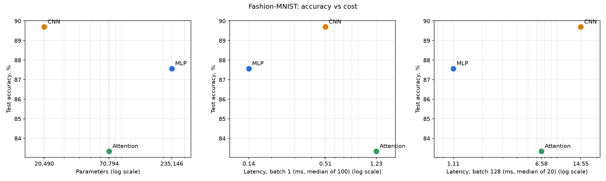

# Lab 3: Architectures and their costs

## Setup

- Hardware: AMD Ryzen 5 5500U (6 cores / 12 threads), 15.3 GB RAM, no GPU; PyTorch uses 6 threads
- Software: Windows 11, Python 3.11, torch 2.14.1+cpu, torchvision 0.29.1+cpu, torchinfo 1.8.0, thop 0.1.1
- Data: Fashion-MNIST, 55k train / 5k val (random split, seed 0) / 10k official test, batch 128,
  `ToTensor()` + `Normalize((0.2860,), (0.3530,))`
- Code in `src/`: `common.py` (data, models), `cost.py` (params, FLOPs, latency), `train.py`, `plot.py`.
  Raw numbers: `results/cost.json`, `results/accuracy.json`.

## 1. Models and parameter counts (torchinfo)

| Model | Architecture | Params |
|---|---|---|
| MLP | 784 → 256 → 128 → 10, ReLU | 235,146 |
| CNN | Conv(1→16) → pool → Conv(16→32) → pool → Linear(1568, 10) | 20,490 |
| Attention | 16 patches 7×7 → Linear(49, 64), 2 encoder layers (4 heads, FF 128), mean pool → Linear(64, 10) | 70,794 |

Breakdown:

- MLP: 784·256+256 = 200,960; 256·128+128 = 32,896; 128·10+10 = 1,290.
- CNN: conv1 1·16·9+16 = 160; conv2 16·32·9+32 = 4,640; linear 1568·10+10 = 15,690.
- Attention: patch projection 49·64+64 = 3,200; per encoder layer 33,472 (QKV 12,480, out_proj 4,160,
  FFN 8,320 + 8,256, two LayerNorms 256); ×2 = 66,944; head 650.

**Note on the 100k–150k target.** None of the specified architectures falls inside it: the MLP is above
(235k) and the CNN (20k) and Attention (71k) are below. The MLP has 11.5× more parameters than the CNN,
so the comparison is between architectures as specified, not at equal size. This works against the CNN
in accuracy, yet the CNN still wins on accuracy (section 4).

## 2. FLOPs: hand calculation vs thop

Formulas (Reddi Ch. 4), per single image, multiply and add counted separately, biases not counted:

- Linear: `2 × in × out` (×seq for token-wise layers)
- Conv2d: `2 × K × K × C_in × C_out × H_out × W_out`
- Attention: QKV `2 × seq × d_model × 3·d_model`, scores `2 × seq² × d_model`, scores·V `2 × seq² × d_model`,
  output projection `2 × seq × d_model²`

### One layer of each type

| Layer | Calculation | Hand FLOPs |
|---|---|---|
| MLP: Linear 784→256 | 2 × 784 × 256 | 401,408 |
| CNN: Conv2d 16→32, 3×3, out 14×14 | 2 × 3 × 3 × 16 × 32 × 14 × 14 | 1,806,336 |
| Attention: QKV projections (seq=16, d=64) | 2 × 16 × 64 × 192 | 393,216 |
| Attention: scores QKᵀ | 2 × 16² × 64 | 32,768 |
| Attention: scores · V | 2 × 16² × 64 | 32,768 |

### Whole model

MLP: 401,408 + 65,536 + 2,560 = **469,504**.
CNN: conv1 225,792 + conv2 1,806,336 + linear 31,360 = **2,063,488**.
Attention:

| Part | FLOPs | Seen by thop? |
|---|---|---|
| Patch projection 2·16·49·64 | 100,352 | yes |
| per layer: QKV | 393,216 | **no** |
| per layer: QKᵀ + scores·V | 65,536 | **no** |
| per layer: out_proj 2·16·64·64 | 131,072 | **no** |
| per layer: FFN 2·16·64·128 × 2 | 524,288 | yes |
| × 2 layers | 2,228,224 | |
| Head 2·64·10 | 1,280 | yes |
| **Total** | **2,329,856** | |

| Model | Hand FLOPs | thop MACs | thop × 2 | thop / hand |
|---|---|---|---|---|
| MLP | 469,504 | 234,752 | 469,504 | 100 % |
| CNN | 2,063,488 | 1,031,744 | 2,063,488 | 100 % |
| Attention | 2,329,856 | 591,488 | 1,182,976 | 51 % |

### Why the numbers differ

1. **Units.** thop reports MACs (multiply-accumulate). One MAC is 2 FLOPs, so the raw thop number is half of
   the Ch. 4 count. After ×2 the MLP and CNN match exactly. This also shows that thop, like the hand
   formula, ignores biases, ReLU and max pooling (they are cheap element-wise ops).
2. **Missing rules for attention.** thop only counts modules it has a rule for. With `report_missing=True`
   it prints `Cannot find rule for MultiheadAttention` and `NonDynamicallyQuantizableLinear` (the class of
   `out_proj`) and counts them as zero. `MultiheadAttention` computes QKV, QKᵀ and scores·V through
   functional calls (`F.multi_head_attention_forward`) that have no module hooks. So the whole
   self-attention block is invisible: 589,824 FLOPs per layer, 1,179,648 for two layers, which is half of
   the model.
3. **Extra in thop.** thop counts LayerNorm (4 ops per element, 4,096 MACs per norm), which the hand
   count leaves out: 16,384 MACs = 32,768 FLOPs. Check:
   2,329,856 − 1,179,648 (missed attention) + 32,768 (LayerNorm) = 1,182,976 = thop × 2.

Conclusion: thop is reliable for Linear/Conv models, but for attention it undercounts by about 2×. For
transformers the FLOPs have to be counted by hand or with a tool that traces functional ops.

## 3. Inference latency

Protocol: `model.eval()`, `torch.inference_mode()`, random input, 10 warm-up runs, then median of 100 runs
(batch 1) and 20 runs (batch 128) with `time.perf_counter`. Main values are from `results/cost.json`. The
range covers that run plus 3 repeat runs.

| Model | Batch 1, ms | range | Batch 128, ms | range | per image at b128 | images/s at b128 |
|---|---|---|---|---|---|---|
| MLP | 0.135 | 0.135–0.152 | 1.109 | 0.757–1.109 | 8.7 µs | ~115,000 |
| CNN | 0.510 | 0.430–0.510 | 14.554 | 14.55–16.05 | 113.7 µs | ~8,800 |
| Attention | 1.233 | 1.233–1.373 | 6.576 | 6.58–7.81 | 51.4 µs | ~19,500 |

Run-to-run noise reaches ~45 % for the shortest timing (MLP at batch 128: 0.757 vs 1.109 ms) and is
10–20 % for the others. The ordering of the models never changed.

Derived numbers (hand FLOPs, main run):

| Model | FLOPs / param | Speed-up from batching (b1 × 128 ÷ b128) | Achieved GFLOP/s, b1 | Achieved GFLOP/s, b128 |
|---|---|---|---|---|
| MLP | 2.0 | 15.6× | 3.5 | 54.2 |
| CNN | 100.7 | 4.5× | 4.0 | 18.1 |
| Attention | 32.9 | 24.0× | 1.9 | 45.4 |

## 4. Accuracy (5 epochs, Adam, lr 1e-3, batch 128)

| Model | Val acc by epoch, % | Test acc, % | Training time, s |
|---|---|---|---|
| MLP | 85.50 → 86.10 → 87.50 → 88.44 → 88.50 | 87.57 | 111 |
| CNN | 85.64 → 88.66 → 89.20 → 90.22 → 89.98 | **89.70** | 163 |
| Attention | 78.56 → 81.82 → 82.88 → 83.96 → 84.12 | 83.34 | 281 |

The Attention model was still improving at epoch 5 (train loss 0.456 → 0.432), so it is undertrained.
The MLP and CNN have nearly plateaued.

## 5. Trade-offs

**FLOPs do not predict latency.** The CNN needs 4.4× the FLOPs of the MLP but is 13× slower per image at
batch 128. The Attention model has about the same FLOPs as the CNN but is 2.2× faster at batch 128 and 2.4×
slower at batch 1. The achieved GFLOP/s column shows why: the same CPU runs the MLP at 54 GFLOP/s and the
CNN at 18. What matters is how each architecture accesses memory (Ch. 4.6–4.7).

- **MLP: dense matrix multiplication.** Every weight is used exactly once per image (2 FLOPs per
  parameter), so at batch 1 it is a matrix-vector product limited by reading 0.94 MB of weights. At
  batch 128 the same weights are reused by 128 images: three large GEMMs with sequential, cache-friendly
  access. That is the operation CPUs and BLAS libraries are most optimised for, hence 54 GFLOP/s and a
  15.6× gain from batching. The intermediate activations are tiny (384 values per image).
- **CNN: small kernels, large activations.** The weights have the highest reuse (~100 FLOPs per parameter),
  but the weights are only 80 KB. The cost is in the activations: conv1 produces 16×28×28 = 12,544 values
  per image, about 6.4 MB per batch of 128. That is as large as the CPU's whole L3 cache. These
  activations are written and read several times (conv → ReLU → pool, each a separate pass over memory),
  so the CNN is limited by activation traffic, not arithmetic. The convolutions themselves are very narrow
  (1 and 16 input channels), which leaves the CPU's vector units underused. Batching barely helps (4.5×)
  because the activation volume grows with the batch.
- **Attention: many small operations.** Each encoder layer is a dozen separate kernels: QKV, head split,
  QKᵀ, softmax, scores·V, out_proj, residual add, LayerNorm, two FFN linears, add, LayerNorm. With 16
  tokens of width 64 each kernel does little work, so at batch 1 fixed per-operation overhead dominates
  (1.9 GFLOP/s, the slowest model). Batching gives these kernels enough work (24× gain, 45 GFLOP/s). The
  seq² score matrix is negligible here (16² entries), but it would dominate for longer sequences.

**Which architecture is most cost-effective?**

- By accuracy per parameter (model size, memory footprint) the **CNN** wins clearly. It is the most
  accurate (89.7 %) with 11× fewer parameters than the MLP. Weight sharing is the inductive bias that fits
  images.
- By accuracy per unit of latency on this CPU the **MLP** wins. It is the fastest at both batch sizes
  (4× faster than the CNN at batch 1, 13× at batch 128) and only 2.1 points less accurate.
- The **Attention** model is dominated. The MLP is both faster and more accurate. The CNN is smaller and
  more accurate. Without positional embeddings it treats the image as an unordered bag of 16 patches, and
  with 5 epochs it does not reach its potential.

For CPU inference on 28×28 images the MLP is the most cost-effective choice. If accuracy or model size
matters more than latency, the CNN is better. On a GPU or with an optimised convolution backend the CNN
penalty would shrink, because it is caused by memory traffic and narrow layers, not by FLOPs.

## Limitations

- One training run with one seed. The CNN's val accuracy moved by 0.2 points between epochs 4 and 5, so
  differences under ~0.5 points are not meaningful. The 2.1-point CNN–MLP gap is larger than that.
- CPU only, one machine. Latency varies by up to ~45 % between runs and depends on background load. Results
  on a GPU would differ, especially for the CNN.
- thop misses the attention block (section 2). Hand counts ignore biases, activations, softmax, LayerNorm
  and pooling.
- The architectures are not parameter-matched (20k–235k, see section 1).
- The Attention model has no positional embedding and was still improving at epoch 5, so its accuracy is a
  lower bound for this architecture family.
- Latency was measured on random inputs, without data loading.
